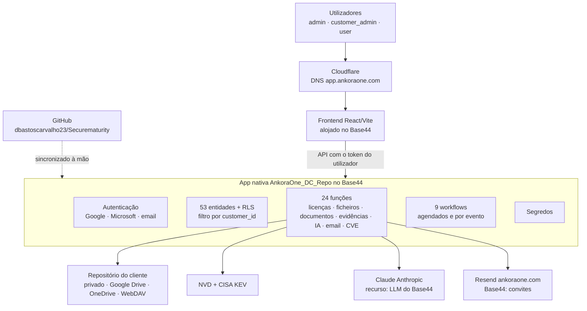

# Arquitetura

Estado a 26 de outubro de 2026. Documento detalhado com auditoria e pendentes: «Securematurity — Arquitetura e Auditoria» (Claude Docs). Plano de migração para servidor próprio: «AnkoraOne — Plano de migração para servidor próprio (Node.js + PostgreSQL)».

## Visão geral

A AnkoraOne corre na app nativa **AnkoraOne_DC_Repo** do Base44 (id `6adf8df867faaf60a171efa5`, plano Enterprise), servida em `https://app.ankoraone.com`. O frontend React fala com a API do Base44 com o token do utilizador; a lógica sensível está em funções no servidor.

## Componentes

| Camada | Onde | Notas |
|---|---|---|
| Frontend | `src/` | React 18 + Vite, tema do Figma, PT-PT/EN, `RouteGuard` por papel e módulo licenciado |
| Entidades | `base44/entities/*.jsonc` | RLS por cliente (`customer_id`) e por papel; campos reservados com RLS de campo |
| Funções | `base44/functions/*/entry.ts` | Deno; validam papel, cliente e módulo antes de ler ou gravar com *service role* |
| Código partilhado | `base44/shared/` | `mail.ts`, `llm.ts`, `storage.ts`, `storedFile.ts`, `license.ts`, `http.ts`, `audit.ts` |
| Agendamentos | workflows do Base44 | Definições na app; `base44/workflows/` é referência. Cada chamada leva a sessão do proprietário da app (administrador) — sem segredo nos argumentos |
| Dados legais | `src/data/legal/` | Só fontes oficiais; ver `docs/legal/README.md` |

## Fluxos principais

- **Ficheiros:** nunca públicos. Carregamento e abertura pelas funções `files` e `evidence`, com URL assinado de curta duração e registo de auditoria. Repositório e pasta escolhidos por cliente (`docs/repositorio-documental.md`).
- **Documentos:** gravação, aprovação com assinatura, versões e reposição pela função `documents`.
- **IA:** funções `aiDraft` (rascunhos com fontes oficiais) e `aiAssist` (pedidos da interface), com motor e pontos ativos escolhidos em Definições → Aplicação (`docs/ia.md`).
- **Licenças:** catálogo e subscrições pela função `licensing`; certificados assinados Ed25519.
- **Email:** `base44/shared/mail.ts` (Resend, SMTP ou Base44); ver `docs/email-dominio.md`.

## Publicação

Ver `docs/deploy-base44.md`.